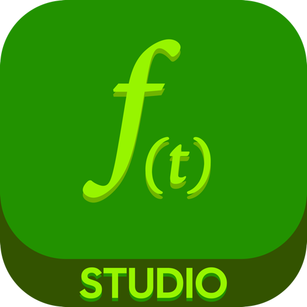

# FishTools Studio — Standalone Multiplatform App

<div align="center">
  
  <h3>Professional Motion Graphics & Video Editing Studio</h3>
  <p>Universal multiplatform app built with React Native, full hardware GPU acceleration, and dynamic OTA updates.</p>
</div>

---

[English](#english) • [Bahasa Indonesia](#bahasa-indonesia)

---

<a name="english"></a>
## Features & Architecture

**FishTools Studio Standalone** (`com.cutefishaep.ofts`) packages the official **Studio** motion graphics web application into a high-performance native desktop and mobile shell with:

1. **Full GPU Acceleration ("Akses GPU Penuh")**
   - **macOS Universal (`arm64` + `x86_64`)**: Metal hardware acceleration enabled via `WKWebViewConfiguration` with `webGLEnabled`, `webGPUEnabled`, and `acceleratedDrawingEnabled`. Discrete GPU priority forced via `NSSupportsAutomaticGraphicsSwitching: false`.
   - **Windows (`x64`)**: DirectX 12 hardware acceleration via Microsoft Edge WebView2 with `--enable-gpu-rasterization`, `--enable-zero-copy`, `--enable-webgl2-compute-context`, and hardware WebCodecs video decoding.
   - **Android**: Full hardware rendering via `android:hardwareAccelerated="true"`, `android:largeHeap="true"`, and Vulkan/OpenGL ES hardware layer compositing.
   - **GPU Telemetry Bridge**: Runtime JavaScript injection detecting GPU Vendor, Unmasked Renderer (e.g., Apple M-Series Metal, NVIDIA RTX, Adreno, Mali), WebGL2, WebGPU, and max texture resolution.

2. **Dynamic Live Updates ("Dinamis Update")**
   - **Repo Sync**: `npm run sync:studio` synchronizes production assets directly from `../Studio` into the standalone assets bundle with SHA-256 integrity verification.
   - **Over-The-Air (OTA) Updates**: The runtime updater checks `https://studio.cutefish.my.id/version.json` or custom endpoints, downloads updated asset bundles, and dynamically switches the WebView root without requiring native binary recompilation.
   - **Mode Switcher**: In-app control bar allows toggling between:
     - *Official Cloud Live*: `https://studio.cutefish.my.id`
     - *Local Dev Server*: `http://localhost:8080`
     - *Offline Embedded Bundle*: Zero-network local bundle with ServiceWorker caching
   - **Deep Linking**: Built-in deep link support for `fishtools://`, `openfishtools://`, and verified App Links.

---

## Directory Structure

```
Standalone/
├── src/
│   ├── App.tsx                   # Main UI shell with GPU HUD & Mode Switcher
│   ├── bridge/
│   │   └── GPUBridge.ts          # GPU diagnostic injection & native bridge
│   ├── updater/
│   │   └── DynamicUpdater.ts     # Dynamic OTA update engine & storage manager
│   └── assets/studio/            # Synced Studio production bundle & manifest.json
├── macos/                        # macOS Xcode project & Metal configuration
├── windows/                      # Windows WinUI / WebView2 DirectX configuration
├── android/                      # Android Gradle project & APK signing
├── shell/                        # Offline launcher, splash loader & deep links
├── certs/                        # Persistent RSA-2048 signing certificates
├── icons/                        # App icons (.icns, .ico, .png)
└── scripts/
    ├── sync-studio.js            # Syncs assets from ../Studio & creates hashes
    ├── build-mac.js              # Compiles macOS Universal (.app & .dmg)
    ├── build-win.js              # Compiles Windows x64 (Setup .exe & Portable .zip)
    ├── build-android.js          # Compiles Signed Android APK (v1+v2+v3)
    ├── generate-ota.js           # Packages OTA zip bundle with checksums
    └── build-all.js              # Master multiplatform build orchestrator
```

---

## Build Commands

### 1. Synchronize Studio Assets
```bash
npm run sync:studio
```

### 2. Build for Specific Platform
```bash
# macOS Universal (arm64 + x86_64) DMG & App
npm run build:mac

# Windows x64 Setup Installer & Portable Zip
npm run build:win

# Android Signed APK (v1 + v2 + v3)
npm run build:android

# Package Dynamic OTA Update Bundle
npm run ota:package
```

### 3. Master Multiplatform Build
```bash
npm run build:all
```

Outputs are placed in:
- macOS: `dist-mac/FishTools_Studio_1.1.0_macOS_Universal.dmg`
- Windows: `dist-win/FishTools_Studio_1.1.0_Windows_x64_Setup.exe` & `dist-win/FishTools_Studio_1.1.0_Windows_x64_Portable.zip`
- Android: `dist-android/FishTools_Studio_1.1.0_Android.apk`
- OTA: `dist-ota/FishTools_Studio_OTA_v1.1.0.zip`

---

<a name="bahasa-indonesia"></a>
## Fitur & Arsitektur (Bahasa Indonesia)

Proyek **FishTools Studio Standalone** merupakan aplikasi multiplatform berbasis React Native yang mengemas editor video gerak (motion graphics) resmi dari folder `Studio` ke dalam executable mandiri untuk macOS Universal, Windows, dan Android dengan fitur utama:

1. **Akses GPU Penuh (Hardware Acceleration)**:
   - **macOS Universal**: Mendukung Apple Silicon (`arm64`) dan Intel (`x86_64`) secara universal. Menggunakan Metal pipeline berkinerja tinggi pada `WKWebView` dengan WebGL 2.0 dan WebGPU aktif.
   - **Windows**: Menggunakan Microsoft Edge WebView2 dengan akselerasi perangkat keras DirectX 12, zero-copy rasterization, serta hardware decoding video WebCodecs.
   - **Android**: Mengaktifkan `hardwareAccelerated="true"`, `largeHeap="true"`, serta hardware layer rendering Vulkan/OpenGL ES.
   - **GPU Telemetry**: Indikator HUD langsung mendeteksi vendor kartu grafis aktif (misal Apple M-series, NVIDIA RTX, AMD Radeon, Qualcomm Adreno) beserta resolusi tekstur maksimum.

2. **Pembaruan Dinamis (Dynamic OTA Updates)**:
   - **Sinkronisasi dari Repo Resmi**: Script `npm run sync:studio` langsung menyalin file produksi terbaru dari folder `../Studio` dan menghasilkan verifikasi integritas berkas SHA-256 (`manifest.json`).
   - **Over-The-Air (OTA) Updates**: Aplikasi secara dinamis dapat mengecek pembaruan versi ke server resmi `https://studio.cutefish.my.id/version.json` dan mengunduh pembaruan tanpa perlu kompilasi ulang aplikasi native.
   - **Mode Fleksibel**: Pengguna atau pengembang dapat beralih antara Server Resmi, Server Pengembangan Lokal (`http://localhost:8080`), atau Bundle Offline Bawaan.
   - **Tautan Langsung (Deep Links)**: Mendukung skema protokol `fishtools://` dan `openfishtools://`.

---

## Lisensi
FishTools Studio Standalone dilisensikan di bawah **GNU AGPLv3**.
Copyright © OpenFishTools Team.
